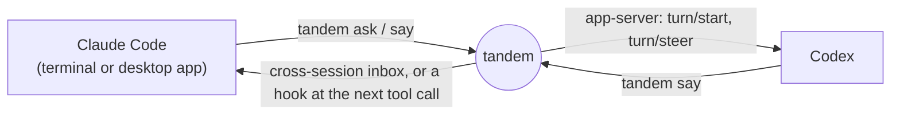

<div align="center">

# tandem

**Claude Code and Codex, working together.**

Your coding agents message each other by name, hand each other work,<br>
and start each other as helpers. Both ways. On Windows, macOS and Linux.

<a href="assets/tandem-demo.mp4"></a>

<sub>The review answers in the video are word for word from a real run. Click it for the full-quality version.</sub>

</div>

## Install

Paste this into Claude Code or Codex:

```
Set up tandem for me: https://github.com/Lampe332/tandem — read SETUP.md there and follow it.
```

Or run one line yourself.

**Windows** (PowerShell)

```powershell
irm https://raw.githubusercontent.com/Lampe332/tandem/main/install.ps1 | iex
```

**macOS and Linux**

```sh
curl -fsSL https://raw.githubusercontent.com/Lampe332/tandem/main/install.sh | sh
```

It needs Python 3.9 or newer and nothing else. The installer puts `tandem` on your PATH, adds its hooks to Claude Code, and gives Claude Code and Codex the skill that teaches them to use it. Run it again to update.

## Use

In Claude Code, type `/tandem`, or just say what you want:

> Start a Codex helper with GPT-6 Luna at medium effort and let it review `src/auth.ts`.

> Ask the reviewer whether the fix is good now.

> Have Codex generate a hero image for the landing page and show it to me.

The agent runs the commands. They are short enough to use by hand too:

```sh
tandem                                   # who is there, and what each is doing
tandem spawn reviewer --kind codex --model "luna 6" --effort medium
tandem ask reviewer "Review src/auth.ts. Which bug matters most?"
tandem say reviewer --file notes.txt     # longer text, from a file
tandem read reviewer --last 2            # its last answers
tandem models                            # models and effort levels spawn accepts
tandem doctor                            # what works, what is missing, how to fix it
```

## What you get

| | |
|---|---|
| **Both directions** | Claude Code can start and ask Codex, and Codex can start and ask Claude Code. |
| **Answers come back on their own** | `tandem ask` returns the reply. Run it in the background and the agent is told the moment the other one is done. If the other agent forgets to reply, its last message comes back instead. |
| **Your choice of model** | `--model` and `--effort` work the same for both engines. Codex models can be named loosely: `"luna 6"` is `gpt-6-luna`. |
| **Nothing is typed into a terminal** | Messages go through each engine's own input: Claude Code's cross-session inbox and Codex's app-server. A draft you are typing stays intact, and an approval prompt never gets an Enter. |
| **Real states** | `working`, `idle`, `blocked(permission)`, `waiting-on(name)`: read from the engines, not from the screen. |
| **Files and images** | A message carries a path. Codex generates an image, sends where it saved it, and Claude opens it. |

## How it works



Each session registers itself through a small hook. A message is written to a mailbox on disk, and a short-lived worker hands it to the recipient's engine. There is no daemon to keep running and no service to install.

## One setting that is yours

By default a message reaches a busy Claude session at its next tool call, and an idle one at its next turn. `tandem install --accept-inbound` makes an idle Claude take messages at once, by setting `"crossSessionInbound": "accept"` in Claude Code's settings. Any program running as your user can then put messages into your Claude sessions without an approval prompt. Everything above works without it, so turn it on only if you want that.

## Platforms

| | |
|---|---|
| **Windows 11** | Tested with Claude Code (terminal and desktop app) and Codex. No WSL and no tmux: helpers open in a console window of their own. Works from PowerShell, cmd and Git Bash. |
| **macOS, Linux** | Supported through tmux and Unix sockets. `--file`, `--prompt-file`, `--model`, `--effort` and the long `ask` have not been run there yet. |

## Limits

- Claude Code's cross-session inbox is not a public API. tandem uses the protocol it observed and falls back to hooks when that changes, but a Claude Code update can break the fast path.
- A Codex can receive only when it was started by `tandem spawn` or `tandem run codex`.
- An idle Claude helper takes a follow-up message only at its next turn, unless you turned on `--accept-inbound`. Its first task always arrives: `tandem spawn … --prompt-file task.txt`.
- Helpers use your Claude and Codex quota, and on Windows their windows stay open until you close them.

## Uninstall

```sh
tandem uninstall
```

Run it before deleting any files: it takes the hooks out of the engines' settings.

## License

MIT. tandem builds on [peer](https://github.com/oesoll/peer) by oesoll, used under the same license. Not affiliated with Anthropic or OpenAI.
